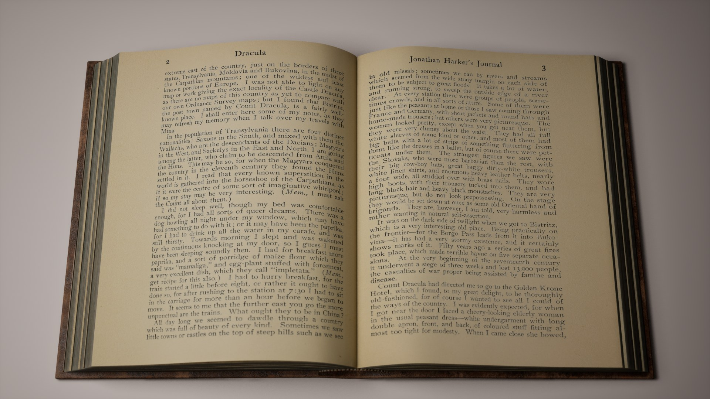
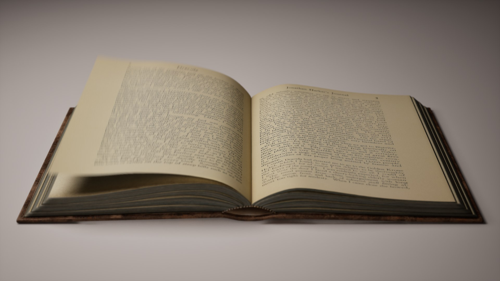
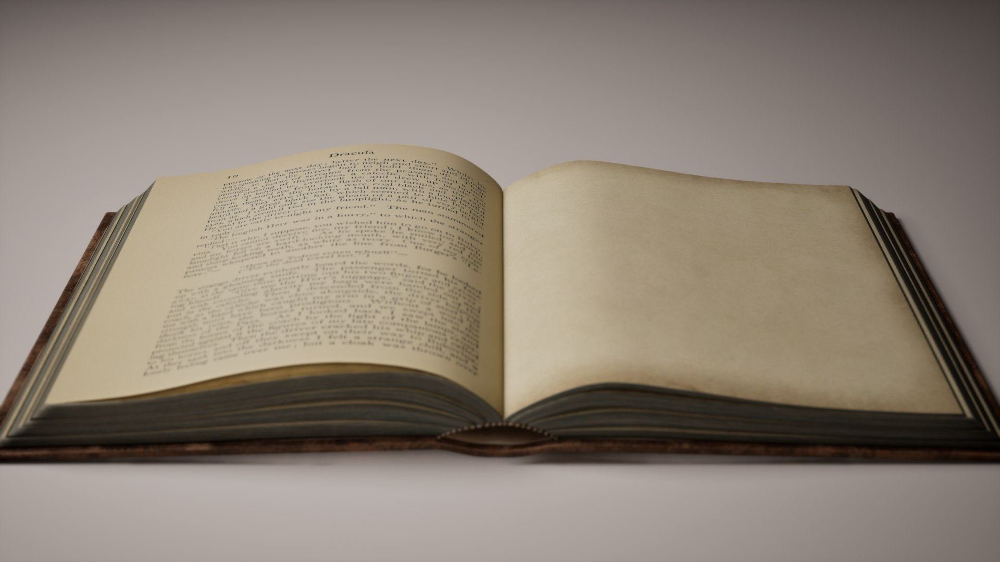
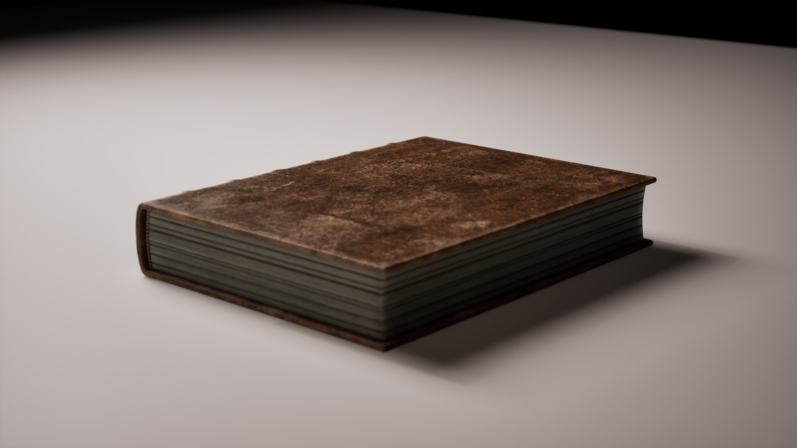

### The Project

This started as a repair job. I had published an animated book on Fab, and buyers
told me two things: the page textures sat wrong, and the pages vanished from one
side. Both were true. The UVs of the page meshes pointed at texture tiles that
didn't exist, the left page and the turning pages were mapped upside down, the
turning pages faced the wrong way, and the material was single-sided — so half the
time you were looking at the back of a page that Unreal simply didn't draw. On top
of that, the turning pages sat a tenth of a millimetre above the page below them
and, after landing, cut up to 1.6 mm through it.

Fixing it properly turned into rebuilding it. The book is now a Blueprint that
reads its pages from a folder: drop in ten page images and it turns five pages;
drop in forty and it turns twenty. The default pages are chapter I of Bram
Stoker's *Dracula* (1899), from a public-domain scan.

<video src="showcase.mp4" autoplay muted loop playsinline style="width:100%;border-radius:8px"></video>

### How It Works

The animation itself was made in 3ds Max and baked to geometry caches.
Instead of baking every page of every possible book, the Blueprint plays just three
pieces and swaps textures:

- **the book opening** (played backwards, it is also the book closing),
- **one page turn**, reused for every page,
- **that same turn frozen at its last frame**, as the page resting on the left.

Each turn, the Blueprint sets four textures — the turning page's front and back,
the new right-hand page and the left-hand page — so a book with 200 pages costs the
same as one with 10. A single clock drives all three caches through manual ticking,
which keeps texture swaps and geometry exactly in step.

The pages use one two-sided material: the front shows one texture, the back
another, mirrored so the text reads correctly when a page lands. In Blender I moved
every UV set into the 0–1 range, reoriented the flipped pages, reversed the turning
pages' normals, pushed every page at least 0.6 mm clear of the one below, and
copied the turning page's UV layout onto the static pages — otherwise the texture
visibly jumped by up to 104 px at the moment a page took over from the one beneath.

### Using Your Own Pages

1. Import your page images into `Content/Old_Book/Textures/Pages`, one texture per
   page, named in reading order with leading zeros: `Page01`, `Page02` … `Page10`.
2. Drag `BP_OldBook` into your level. It scans the folder, sorts the pages by name
   and fills its page list.
3. Press Play: the book waits closed for two seconds, opens, turns one page per two
   images, closes and loops.

| Pages in the folder | Page turns | Last spread |
| --- | --- | --- |
| 10 | 5 | page 10 left, blank right |
| 9 | 4 | page 8 left, page 9 right |
| 40 | 20 | page 40 left, blank right |

Page 1 is the first right-hand page. The inside of the cover and anything past the
end of your list show a blank sheet of aged paper, which ships as its own texture
for empty books. Pages are portrait at 3:4; other sizes stretch to that shape. The
scan runs in the editor and the list is saved with the level, so packaged games
need no folder access.

### Settings

Everything sits on the placed actor under **Book** in the Details panel.

| Setting | Default | What it does |
| --- | --- | --- |
| Pages | Dracula 1–10 | Page textures in reading order, filled from Pages Folder when Auto Refresh Pages is on. |
| Pages Folder | `/Game/Old_Book/Textures/Pages` | Content folder scanned for page textures, sorted by name. |
| Auto Refresh Pages | on | Rescan the folder whenever the actor changes in the editor. |
| Blank Page | `T_Paper_Blank` | Inside of the cover and any page past the end of the list. |
| Start Delay | 2 s | Time the book stays closed before it opens, every loop. |
| Play Opening / Play Closing | on | Play the cover opening and closing. Off = the book starts or stays open. |
| Turn Duration | 1.25 s | Time one page takes to turn and settle. |
| Pause Between Turns | 0.25 s | Rest between two turns. |
| Pause At End | 0 s | Extra rest after closing, before the next loop. |
| Play Rate | 1.0 | Overall speed. |
| Auto Play | on | Animate at runtime. |
| Preview Time | 4.2 s | Pose shown in the editor viewport, in seconds into the loop. |

One loop lasts *start delay + opening (2.17 s) + turns × (turn duration + pause) +
closing (2.17 s) + pause at end* — 13.8 seconds at the defaults with ten pages.

### Rendering

The project includes two camera sequences and a high-quality Movie Render Queue
preset (1080p, 16 temporal samples, cinematic quality): `LS_OldBook_Render`, a
single slow push-in over one loop, and `LS_OldBook_Showcase`, five cameras cut to
the animation's phases. The demo level is lit with Lumen — a soft key light and a
shadowless fill from the reader's side — so there is nothing to bake.

### Troubleshooting

| Symptom | Fix |
| --- | --- |
| Pages don't turn and the book never closes | Make sure **Manual Tick** is on for the **BookCache**, **PageTurn** and **LeftRestPage** components (it is on a freshly placed book). |
| Wrong pages, or none | Check **Pages Folder** points at your folder and the files are Texture2D assets. |
| Pages in the wrong order | Rename with leading zeros so they sort by name. |
| "Expects texture to be Virtual" warning | Turn **Virtual Texture Streaming** off on the page textures. |

### An Honest Limitation

When the book closes, the resting left page hands over to the book's own left page,
and the two have slightly different curls. The texture now lines up within about
18 px on a 3061 px page, so at close range you may catch a small shift in the paper
at that moment.

### Credits

Page textures: Bram Stoker, *Dracula*, New York: Doubleday & McClure, 1899,
chapter I, pages 1–10, scanned by
[Smithsonian Libraries](https://library.si.edu/digital-library/book/dracu00stok)
and released under CC0 1.0
([Internet Archive](https://archive.org/details/dracu00stok)).
