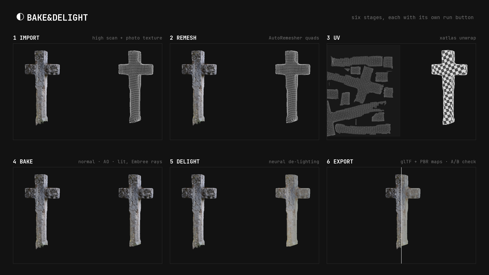
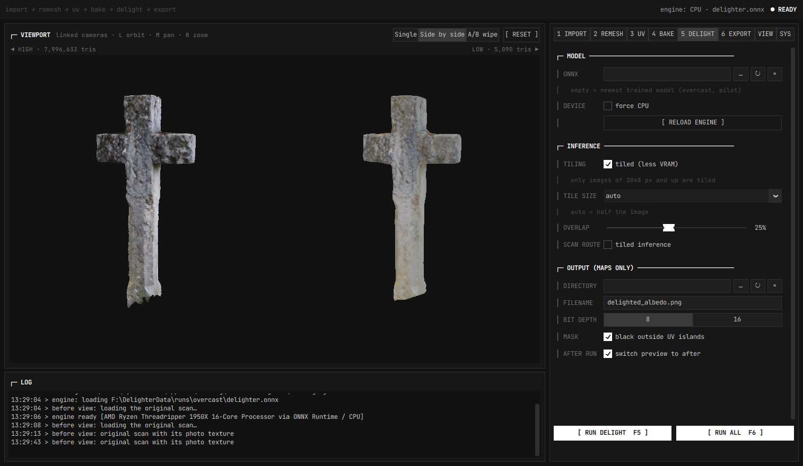
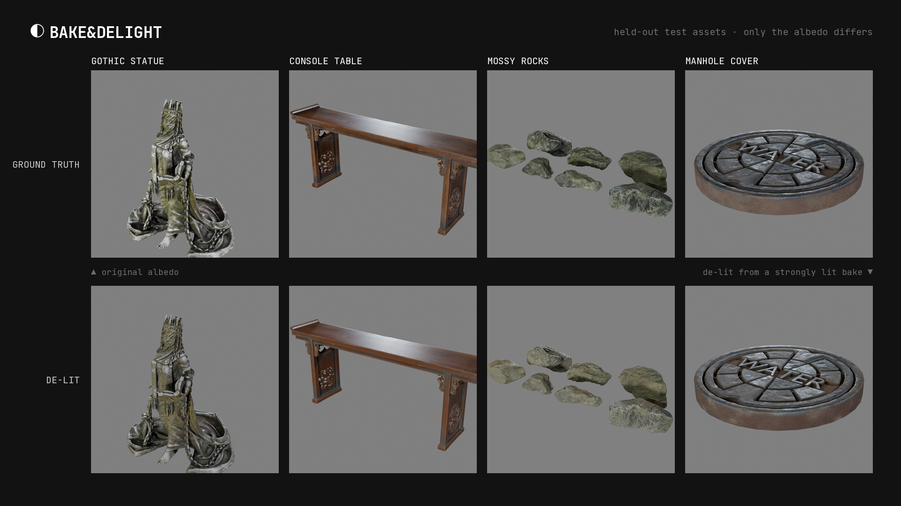

### The Problem

A photogrammetry scan looks wonderful the moment it comes out of the solver, and is
almost useless as it is. The mesh has millions of triangles. The UVs are a scatter of
thousands of tiny islands. Worst of all, the texture is made of photographs, so the
light of the afternoon you shot it in is painted into the colour: every shadow, every
highlight, the blue of the sky on one side and the warm bounce from the ground on the
other. Put that asset into a scene with its own lighting and it is lit twice.

Fixing this by hand is a day of work per asset. You retopologise, unwrap, bake the
normals and the ambient occlusion from the high mesh, and then paint the lighting out
of the colour map. **Bake&Delight** does all of it in one window.

### Six Stages

The tool is built as a pipeline you can run in one go, or one stage at a time. Each
stage has its own tab and its own run button, so you can stop, look and tweak:

1. **Import:** the high-res scan with its photo texture, in OBJ, PLY, FBX or glTF.
2. **Remesh:** clean quads with AutoRemesher, or plain triangle decimation. The scan
   is first reduced to about twice the target size, so an eight-million-triangle mesh
   is remeshed in minutes instead of hours.
3. **UV:** an automatic unwrap with xatlas, packed for the chosen texture size.
4. **Bake:** normal map, ambient occlusion and the photo colour are projected from the
   high mesh onto the low one by ray casting on the CPU with Embree. No Blender and no
   GPU needed.
5. **Delight:** a neural network removes the baked-in lighting from the colour, using
   the normal and occlusion maps to tell shading from surface colour.
6. **Export:** a glTF with a full PBR material (albedo, normal, roughness, occlusion)
   plus the separate texture maps.

The viewport always compares the high scan with the low result, side by side or with
an A/B wipe, both in the same frame so they line up exactly. The 3 UV tab shows the
layout next to the model instead.

### The De-Lighter

The de-lighting began as the open-source
[AI Texture De-Lighter](https://github.com/vdmrcll/ai-texture-delighter) by vdmrcll,
published under the MIT licence. The code is public, but the project ships without
trained weights. So I built the training pipeline myself and trained a new model from
scratch on data anyone may use.

The training set comes from 337 CC0 scanned models from [Poly Haven](https://polyhaven.com).
Each one is baked under twelve random real-world HDRI environments, which gives pairs
of lit colour and true albedo. The first model is trained for overcast light, the
most common way scans are shot. On held-out assets it cuts the error against the
true albedo by more than 40 % compared with leaving the lighting in.

It is not perfect yet. Strongly saturated colours drift: green moss comes out beige,
and bright white straps pick up colour. A second model for hard sunlight is next.

### Under the Hood

Bake&Delight is written in Python. The geometry backend runs without Blender:
Embree for ray casting, xatlas for unwrapping, fast-simplification for decimation and
AutoRemesher for quads. ONNX Runtime runs the network. If Blender is installed, it can
serve as an alternative backend for unwrapping and baking. Besides the interface there
is a command-line tool, so scans can also be processed from scripts.

The interface is deliberately quiet: greyscale and monospace, with no colour in the
chrome, so the only colour on screen is the scan itself.

### Status

Bake&Delight is in active development and not public yet.
