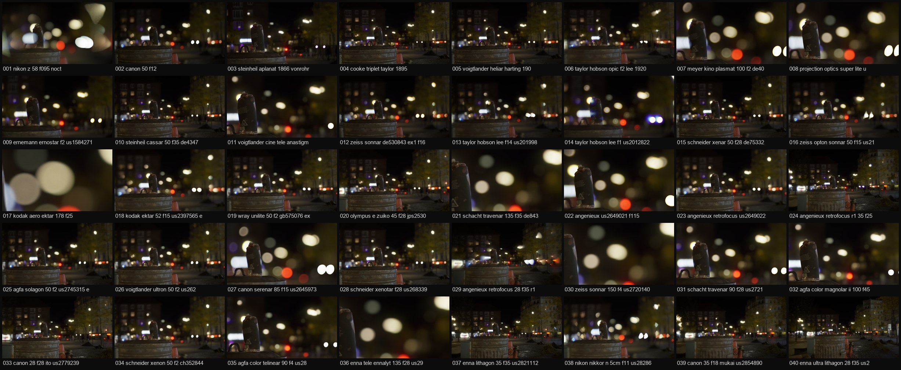

### The Project

blenser is a camera for Blender's Cycles renderer that is built from real lenses. Each lens comes from its
designer's own prescription, transcribed from the patent: every glass surface, its curvature, its glass type, its
spacing. The camera ray is traced through that glass surface by surface, at many wavelengths, and what comes out
is what the lens really does: bokeh that turns into cat's eyes towards the corners, colour fringes from the glass
dispersion, vignetting from the real clear apertures, distortion and focus breathing as designed.

Blender's own camera is a perfect pinhole with a perfect blur. The difference is easiest to see at night.



### The Ghost Reel

To see how differently lenses draw, I put twenty-seven well-known ones on the same shot: the same camera position, the
same focus at 1.66 m, each lens wide open. Twenty-two spherical lenses span 186 years, from the Petzval portrait
lens of 1840 through the Tessar, Biotar, Sonnar and Planar to the Noctilux, Canon's 50 mm f/0.95 "Dream Lens",
Nikon's Noct and today's Sony, Sigma and Canon primes, and cinema primes from Cooke, ARRI/Zeiss and Leica. Five are
anamorphic: Cooke, Zeiss Master Anamorphic, DZOFilm, Sirui and Atlas Mercury.

The street lamps were turned up so every lens throws its flare ghosts: the reflections between its glass surfaces.
Uncoated pre-war designs scatter big, soft rings across the frame; modern multi-coated glass keeps them faint.

Click any frame to browse all of them full screen; step with the arrow keys or swipe.



### Rendering on a Farm

Thirty lenses at 1920 × 1080 is a long night for one computer, so the reel went to
[SheepIt](https://www.sheepit-renderfarm.com), the free community render farm. SheepIt runs no Python, so the
whole reel had to live inside one .blend: one camera per lens with its lens shader compiled into the file, and
timeline markers that switch to the next camera on every frame. The farm renders it as an ordinary 30-frame
animation, to EXR so the light above white survives.

On the farm the 30 frames took 1 h 51 min of machine time and came back in 1 h 32 min. Most lenses rendered in one
to four minutes per frame; the slowest, an anamorphic zoom, took 21. Three lenses with extreme fields of view were
left out of the reel above, and five frames were rendered again: three lenses swapped for others, the
Petzval reframed, and the Nikon Noct with a corrected shader at four times the samples.

The ghosts themselves are added afterwards, without noise: blenser finds the brightest lights in each EXR and
traces their ghost paths through that frame's lens.



### Two Hundred Lenses

The second batch put **200 lenses** on the same shot, from an 1866 Steinheil Aplanat to current mirrorless primes,
at 1,024 samples per pixel. SheepIt limits how long one frame may take, so every lens was rendered as four frames of
256 samples, each with a different random seed, and the four were averaged afterwards: 800 farm frames, 3 days
20 hours of machine time, back in 18 hours 22 minutes.

Every lens here sits at the same camera position, so the field of view does the talking: the 178 mm Aero Ektar
and the 135 and 150 mm teles fill the frame with a single blurred can, the 28 mm wides take in the whole street.

### The Full Collection

These are a sample. blenser ships with **1,295 lenses**, from 1840 to 2026: every classic formula above
plus modern Sony, Canon, Nikon, Sigma, Samyang and Fujifilm primes and zooms, cinema primes and zooms, macros,
soft-focus lenses, smartphone camera modules and **19 anamorphics** from 1.33× to 2×. Each one is named the way
photographers search for it: by focal length, maker, year and patent.

blenser is coming soon to [Superhive](https://superhivemarket.com/).

### Credits

Scene: Hidden Alley by Poly Haven (CC0). Glass data: refractiveindex.info (CC0). Flare method after Hullin et al.,
SIGGRAPH 2011.
