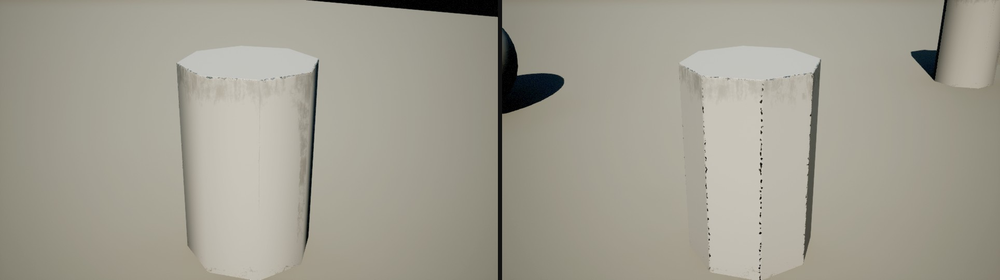
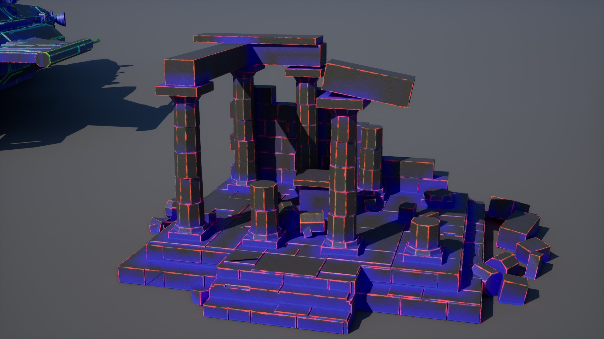

### The Project

EdgeFX grew out of Hullpainter, my Blender tool for plating and weathering hulls.
Hullpainter bakes its wear into the mesh before export; EdgeFX does the same job
inside Unreal, at render time, on any mesh you pick. Select a few actors, pick a
look, and their sharp low-poly edges catch the light like bevels, the paint wears
through along exposed edges, dirt settles into crevices and where other objects are
close, and streaks run down the walls from the top edges.

There is nothing to bake and no UVs to unwrap, and your materials are never touched.
EdgeFX writes into the GBuffer right after the base pass, so Lumen, reflections and
shadows all see the result as if the material had been authored that way.



### What It Does

- **Rounded edges.** Hard edges get a rounded normal over a band you set in
  centimetres. Smooth-shaded faces are left alone: only edges where the mesh's own
  normals jump get rounded.
- **Edge wear.** Paint wears through to bare metal along exposed outer edges, in
  ragged Hullpainter-style chips, or through your own triplanar wear maps.
- **Chipped stone and concrete.** With Wear Tint at 0 and Chip Depth at 1 the
  edges break off instead: the surface keeps its colour and only its shape changes.
- **Dirt.** Your dirt maps collect in inner edges and wherever other geometry is
  close, found through the global distance field.
- **Streaks.** Run-down streaks start under exposed top edges and fade down the
  wall. Under overhangs, walls stay clean.









Each look is a **preset** asset, and up to sixteen presets can be on screen at once,
all in one pass. Every section — rounded edges, edge wear, dirt, streaks — has its own
switch, and edits show live in the viewport. The maps are projected triplanar in
world space and hex-tiled, so they never visibly repeat.

### How It Works

A small pre-pass computes every pixel's face normal from the depth buffer. The GBuffer
normal can't be used for that: it carries the material's normal map, which must
neither count as an edge nor get smoothed away. For each tagged pixel, EdgeFX then
reads a rotated spiral of neighbours and finds the rounded normal within the bevel
radius and the distance to the nearest outer and inner edge. The edge position is
refined by bisection to the exact pixel, so the chip border stays as sharp as the
softness setting says.

Wear and dirt follow the Hullpainter formulas and noise, so EdgeFX matches
Hullpainter exports. Streaks walk up the wall through the global distance field to
find its exposed top edge, which works off screen and from any angle.

### Using It

1. **Make a look.** Tools > EdgeFX > **New Preset…**, or *Data Asset > EdgeFX Preset*
   in the Content Browser. For stone or concrete, create an **EdgeFX Concrete
   Preset** — its reset arrows go back to the chipped-concrete look.
2. **Apply it.** Select the preset and some actors, then Tools > EdgeFX > **Apply to
   Selected**. Each actor gets an EdgeFX component where you can switch its preset or
   turn the effect off.
3. Blueprint: `Set Edge FX (Actor, On, Preset)` and `Has Edge FX (Actor)`.
   Console: `r.EdgeFX 0/1`, and `r.EdgeFX.Debug 2` for the mask view.

| Section | Main settings |
| --- | --- |
| Rounded Edges | Bevel Radius (cm), Bevel Strength, Round Concave |
| Edge Wear | Wear Amount, Edge Width (cm), Threshold, Softness, Chip Scale, Metal Color, Wear Metallic, Wear Tint, Chip Depth, optional wear maps |
| Dirt | Dirt Amount, Dirt Distance (cm), Dirt Color, Contrast, Brightness, dirt maps |
| Streaks | Streak Amount, Length (cm), Color, Contrast, Brightness, streak maps |
| Triplanar Maps | Tile Size (cm), Blend Sharpness, Break Tiling (hex-tiling) |

Project Settings > Plugins > EdgeFX holds the global switches: Tagged Only (or every
opaque mesh with a default preset), the custom stencil range, the sample count, and
Full Resolution Maps, which keeps the preset maps sharp — no material references them,
so the texture streamer would otherwise leave them blurry.

### Performance

Measured on an RTX 3090 at 1920×1080 with 16 samples, on scenes full of tagged
objects:

| Enabled | GPU time |
| --- | --- |
| Rounded edges only | 0.26 – 0.77 ms |
| Rounded edges, wear, dirt, streaks | 0.75 – 1.6 ms |

At 4K it costs about four times as much. Most of it goes into the wear, dirt and
streak maps and the distance-field probes; turning Break Tiling off makes the maps
cheaper.

### Requirements

- Unreal Engine 5.8, Windows, DirectX 12 / Shader Model 6.
- The deferred renderer with the classic GBuffer — Substrate must be off.
- Custom Depth-Stencil Pass set to *Enabled with Stencil* (the plugin switches it on).
- Distance-field dirt and streaks need *Generate Mesh Distance Fields*; without it,
  dirt falls back to inner edges only.
- Static meshes, skeletal meshes and Nanite: anything that renders custom depth.

### Honest Limitations

- **Screen space.** EdgeFX only sees what is on screen. On a silhouette, where the
  second face turns away from the camera, wear and dirt still find the edge, but the
  rounding can't.
- **World-space maps.** The triplanar maps are projected in world space, so on moving
  actors the pattern slides.
- **Coarse distance field.** Distance-field dirt is soft, at the scale of ten
  centimetres or more. On rounded tops — a sphere, a lying cylinder — the field can't
  tell the curve from a real top edge, and a band of streaks can appear around the
  middle; switch Streaks off on such meshes.
- **Shading models.** Only Default Lit and Clear Coat; translucent and unlit surfaces
  are left alone.

### Free Copy for Artists

Are you working on something EdgeFX would suit? Send me a screenshot of your project
as it is now and tell me where you'd use EdgeFX, and promise to send an after picture
once it's in. If it's a good fit, you get a free copy for that project.
[Get in touch](/contact/).



### Credits

- Demo temple ruins and starship: modelled for the demo in Blender, plated with Hullpainter.
- Stone texture: [Poly Haven](https://polyhaven.com) "Rock 01" by Rob Tuytel, CC0.
- Dirt and streak maps: [ambientCG](https://ambientcg.com) SurfaceImperfections015
  and 003, CC0.
