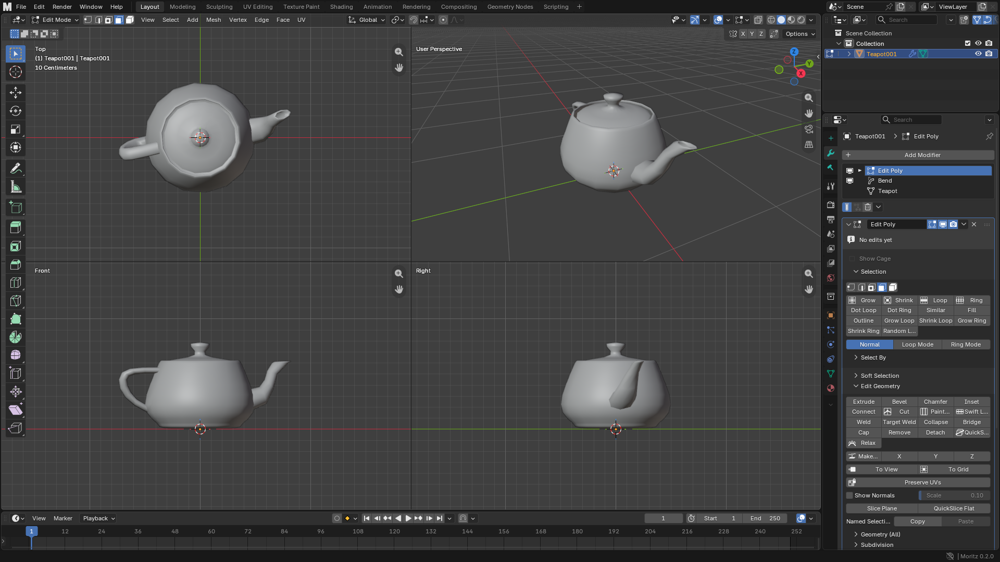

### The Premise

A lot of 3ds Max users have tried to leave it. The reasons to go are good ones: Blender is free, fast, open, and today it
renders, sculpts, animates and builds procedural geometry as well as anything you can
rent. The reasons people come back are almost always the same. It is not that Blender
can't do the work. It is that their hands no longer know where anything is.

I read through thirteen years of switching stories, from forum threads and devtalk
requests to archviz post-mortems. Keymaps and navigation come up in more than half of
them. After that come the things a Max user reaches for without thinking and Blender
simply doesn't have: an Edit Poly modifier in the middle of the stack, primitives you
can still change after you've made them, and proper spline tools.

**Moritz** is my answer. It is Blender 5.3 underneath, and on top it is shaped for
people who think in Max. It is an early alpha: read the Status section before you
rely on it.

### What It Is

It is not a skin and not a keymap preset. It is a fork of Blender with its own
application and its own core changes where an add-on couldn't reach.

- **Your hands work on day one.** Max navigation and shortcuts, W/E/R, 1–5 for
  sub-object levels, the right-click quad menu, Transform Type-In, Align, Clone with
  Shift+drag. A Max keymap and a Blender keymap are one click away, so Blender
  tutorials stay usable.
- **The Command Panel.** Create, Modify and Utilities. Create lists the object types
  in Max's order, and you drag them out with parameters you can still edit afterwards.
- **Editable Poly and Edit Poly.** Vertex, Edge, Border, Polygon and Element, with
  Max's tools under Max's names: Extrude, Chamfer, Connect, Swift Loop, Target Weld,
  Bridge, Smart Extrude, smoothing groups.
- **A real modifier stack.** Edit Poly sits anywhere in the stack while the modifiers
  below stay live, with Collapse To, instanced modifiers and Show End Result. Several
  other Max modifiers (Edit Spline, Cap Holes, ProOptimizer, Quadify Mesh and more)
  are native too.
- **Max's names, if you want them.** Tools, modifiers and menus can use Max's
  vocabulary, Blender's, or follow whichever keymap you picked.

### What It Isn't

Moritz only changes what Max genuinely does better. Where Blender's way is already
good, such as its UV editor, its node systems or its renderers, I left it alone.
Moritz is not an attempt to clone 3ds Max; it is Blender with the gaps closed that
keep sending Max users back.

It also doesn't lock you in. Moritz saves ordinary `.blend` files, and files from
stock Blender open unchanged. A file saved in Moritz opens in Blender 5.3 too, though
Moritz's own modifiers are disabled there until you open it in Moritz again. It
installs next to Blender, not over it.

### Who It's For

- **3ds Max users** in archviz, games and product design who want out of the
  subscription, or who have tried Blender and kept bouncing off its interface.
- **Studios and classes** that run Max and Blender side by side and want one set of
  habits.
- **Students who learned Max** and would rather not start over.

If you are already happy in Blender, you don't need Moritz. That's fine.

### Status

This is **0.2, an early alpha**, for Windows 10/11. Many features are still missing,
and you will run into bugs. Bugs get fixed, so please report every one in
**#bug-reports** on the [Moritz Discord](https://discord.gg/cA9x2yprmG). Missing
something you rely on in Max? Add it to the wishlist in **#feature-requests**.

Moritz is free software
under the GNU GPL, like Blender, and is not made or endorsed by the Blender Foundation
or Autodesk.

    <a href="https://github.com/cyberhirsch/moritz/releases/tag/v0.2.0" class="inline-flex items-center px-8 py-4 text-lg font-bold text-white transition-all bg-primary-600 rounded-lg hover:bg-primary-500 hover:scale-105 shadow-xl shadow-primary-900/20">
        Download Moritz 0.2 &nbsp; &rarr;
    </a>

[Join the Moritz Discord &rarr;](https://discord.gg/cA9x2yprmG)
